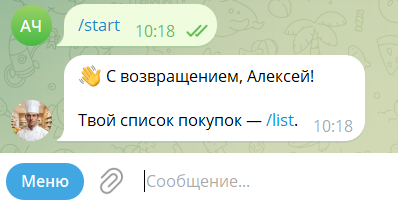
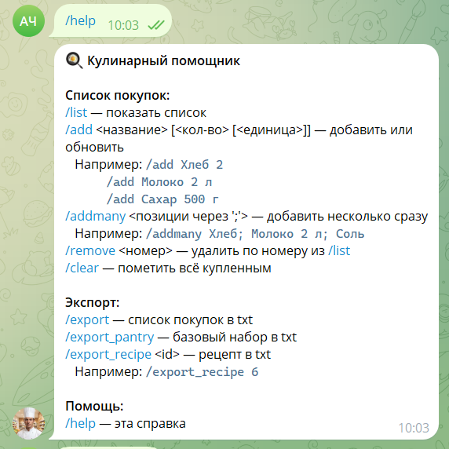
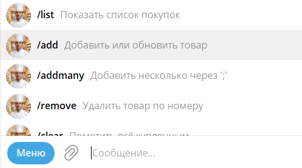
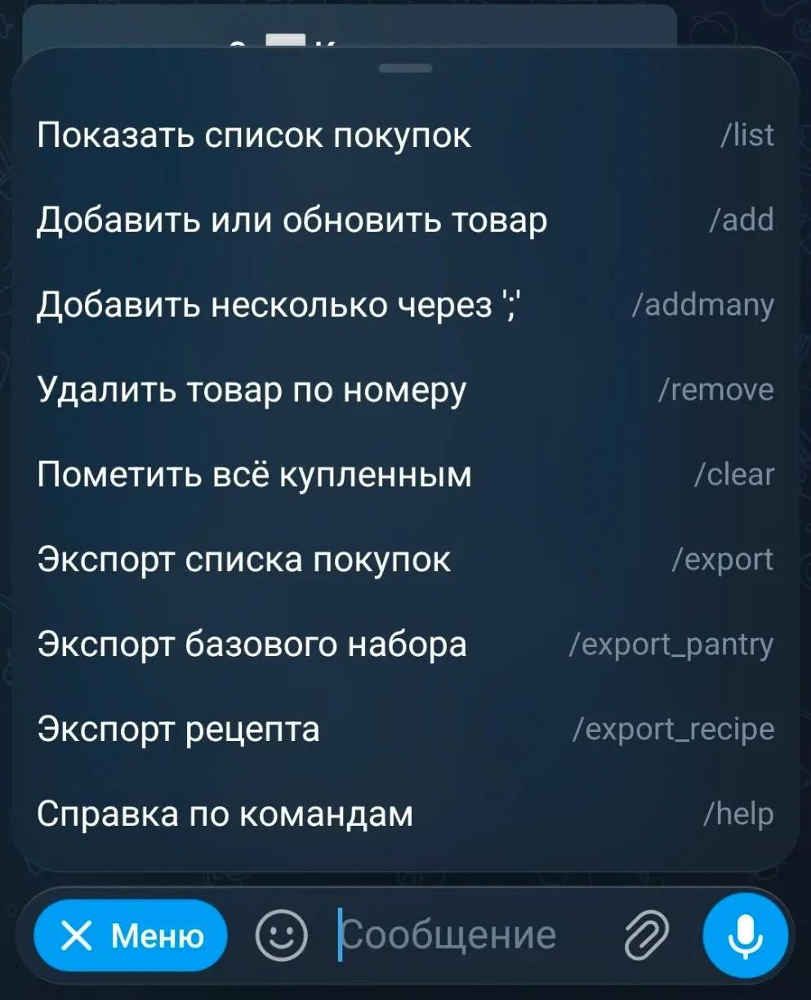
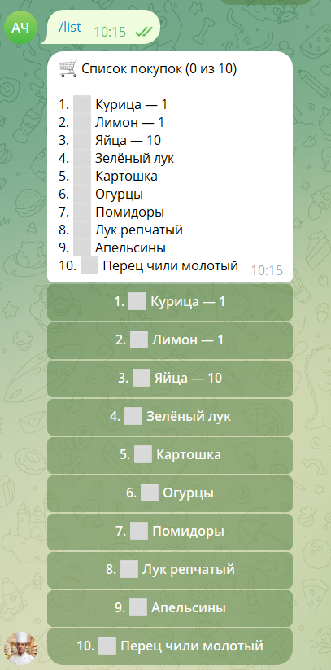
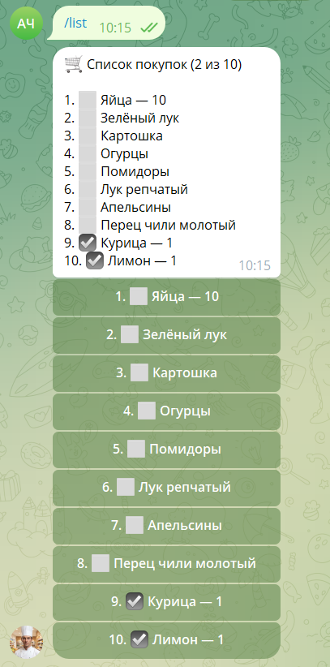

# 🛒 Cookbook Bot — Telegram-бот для списка покупок

> Тонкий клиент для веб-пртложения Cookbook: **9 команд**, inline-кнопки,
> поддержка единиц измерения, устойчивый к сбоям HTTP-клиент.
> **296 автотестов**, покрытие **95.78%**, CI зелёный.

---

## 📸 "Визитка" проекта

| Возвращение | Команды |
|---|---|
|  |  |

| Меню команд — десктоп | Меню команд — мобильная |
|---|---|
|  |  |

| Список покупок | Изменение чекбокса |
|---|---|
|  |  |

---

## 🎯 Описание проекта

Telegram-бот для **списка покупок**. Работает, используя
Django-API: бот — тонкий клиент, данные хранятся в БД основного приложения.

**Аргументация выбранной реализации:**
- Telegram — всегда под рукой, не надо ставить приложение.
- Список покупок передается из Django, в боте может редактироваться.
- Django — хранитель данных, бот — интерфейс, функционал никак не дублируется.

---

## 🧰 Команды

### `/start`
Запуск бота.

### `/help`
Список всех команд с примерами использования.

### `/list`
Текущий список покупок с кнопками для отметки купленного.
Купленное сортируется вниз, в заголовке — счётчик.

### `/add <название> [кол-во] [единица]`
Добавляет или обновляет позицию. Если такая уже есть — обновит количество.
Пример: `/add Молоко 1,5 л`.

### `/addmany <позиции>`
Добавляет несколько позиций одной командой.
Пример: `/addmany арбуз 10 кг, слива 5 шт`.

### `/remove <номер>`
Удаляет позицию по номеру из `/list`.
Пример: `/remove 2` — удалит вторую позицию.

### `/clear`
Помечает всё купленным. Передает обновленный статус в Django.

---

## 🏗 Принцип работы

Бот разбит на **слои**, которые не знают друг о друге:

| Слой | Задача |
|---|---|
| Обработчики команд | Принять команду, ответить пользователю |
| HTTP-клиент | Сходить в Django API, повторить при сбое |
| Схемы данных | Проверить, что API ответил тем, чем нужно |
| Утилиты | Парсинг аргументов, чистые функции |

**Почему так:** каждый слой тестируется отдельно. Хендлеры не знают
про сеть, клиент не знает про Telegram. Это ускоряет тесты и упрощает правки.

---

## 🧪 Качество

| Метрика | Значение |
|---|---|
| Автотесты | **296** |
| Покрытие кода | **95.78%** |
| CI | ✅ GitHub Actions |
| Линтер | ✅ 0 ошибок |
| Проверено на Python | 3.12 / 3.13 / 3.14 |

---

## 💼 Что сделано в этом проекте

- Спроектирована и реализована архитектура **тонкого клиента** над Django API.
- Написано **296 автотестов** (покрытие 95.78%).
- Настроено **CI на GitHub Actions**.

---

## 🔗 Связанные проекты

- **[cookbook_project](../cookbook_project/README.md)**

---
⚠️ **Репозиторий проекта приватный.**
