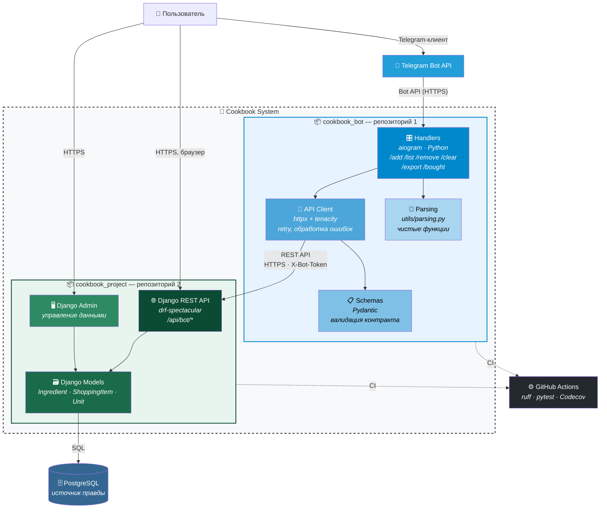

## 2. C4 Container — уровень 2

**Что показывает:** из чего состоит система внутри — контейнеры, слои, два репозитория.

**Ключевое:**
- **Две рамки** — два репозитория (разный цвет).
- **Внутри бота** — 4 слоя: `Handlers → Client → Schemas`, `Handlers → Parsing`.
- **Внутри API** — `DRF → Models → DB`, `Admin → Models`.
- **CI** — общий для двух репо.
- **Одна БД** — только у Django.

