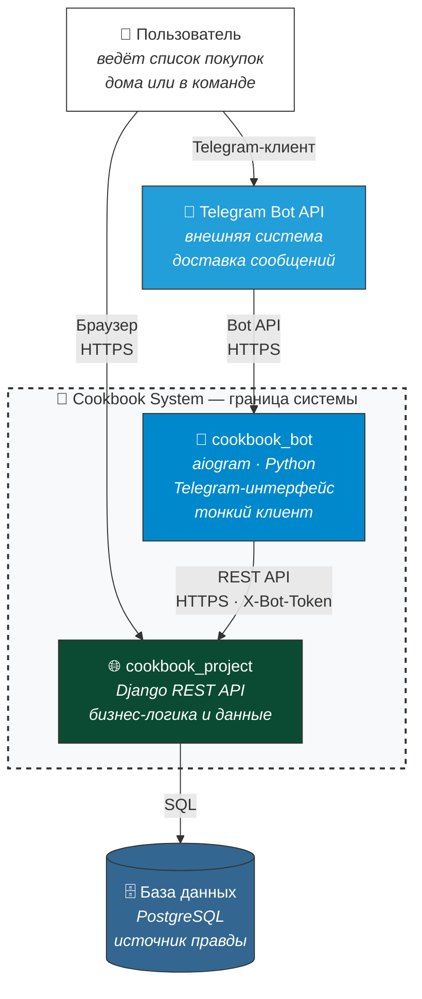

## 1. C4 Context — уровень 1

**Что показывает:** кто пользователь, что наша система, что снаружи.

**Ключевое:**
- **System Boundary** — пунктирная рамка вокруг бота и API.
- **Одна БД** — у Django. Бот **не хранит** состояние.
- **Стрелки:** `User → TG → Bot → API → DB`, `User → API` (браузер).
- **Протоколы подписаны:** `Bot API (HTTPS)`, `REST API (HTTPS, X-Bot-Token)`, `SQL`.

