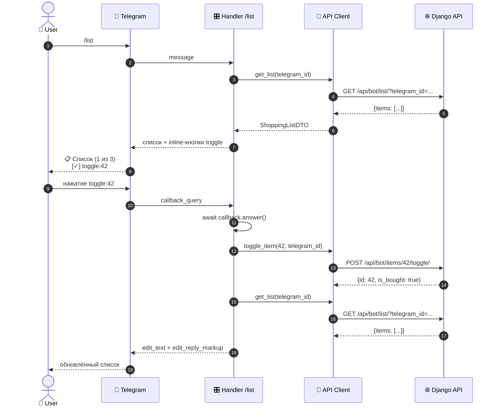

## 4. Sequence — `/list` + toggle

**Что показывает:** callback-flow и правило «`callback.answer()` первым».

---

## 🗂 Легенда

| Иконка | Что |
|---|---|
| 👤 | Пользователь |
| 🤖 | `cookbook_bot` — Telegram-бот (aiogram) |
| 🌐 | `cookbook_project` — Django REST API |
| 🗄️ | PostgreSQL — источник правды |
| 📱 | Telegram Bot API — внешняя система |
| ⚙️ | GitHub Actions — CI |
| 🎛️ | Handlers — слой aiogram |
| 🔌 | API Client — httpx + tenacity |
| 📋 | Schemas — Pydantic |
| 🧩 | Parsing — чистые функции |
| 🗃️ | Django Models |
| 🖥️ | Django Admin |