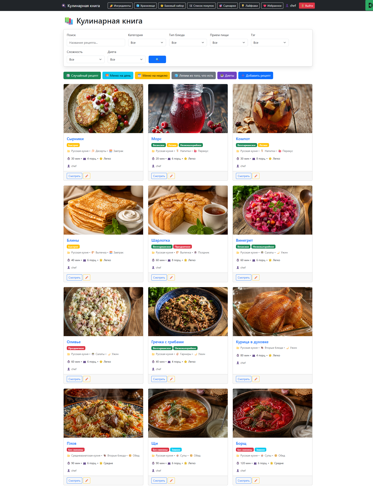
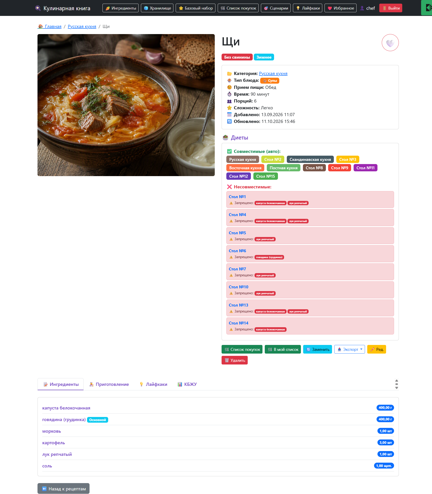
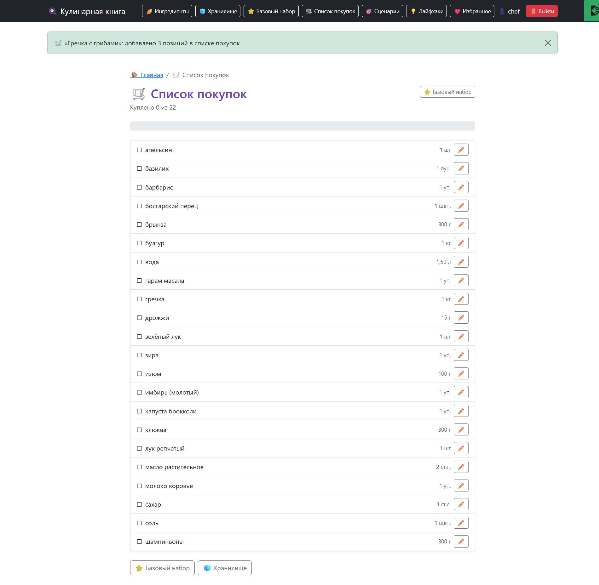
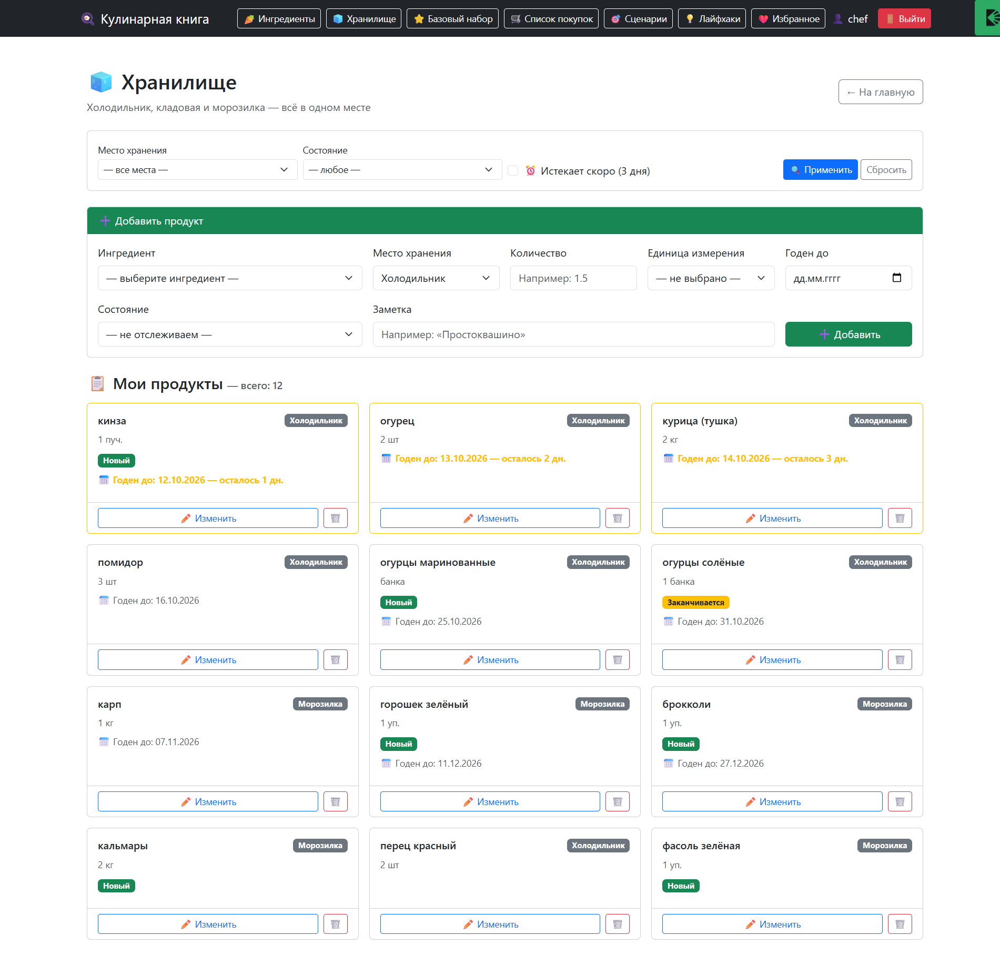
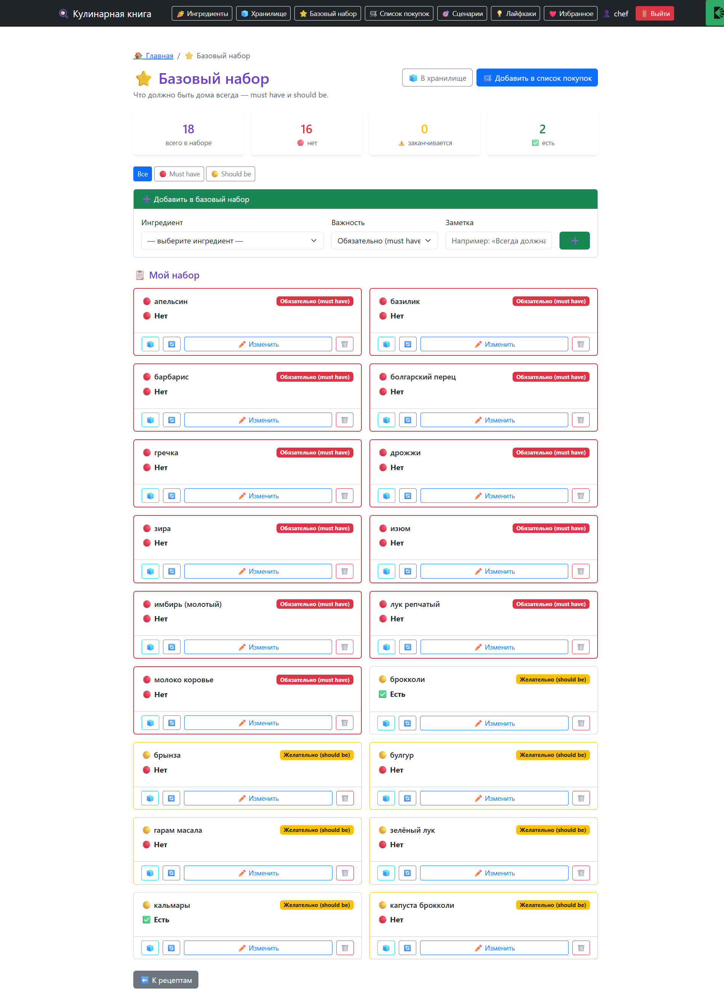
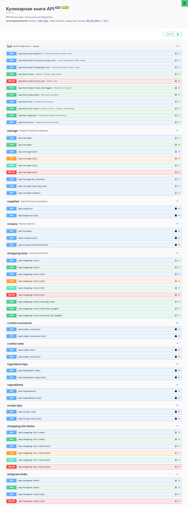

# 🔌 Django API — Cookbook Project

> Веб-приложение на Django: 11 моделей, 11 Bot-эндпоинтов,
> **717 тестов**, покрытие **86–87%**, CI зелёный.

[](https://github.com/Green-noodle/cookbook_project/actions)
[](https://codecov.io/gh/Green-noodle/cookbook_project)


---

## 📸 Проект в картинках:

| Список рецептов | Детальная рецепта | Список покупок |
|---|---|---|
|  |  |  |

| Хранилище | Базовый набор | Swagger UI |
|---|---|---|
|  |  |  |

---

## 🎯 Описание проекта

Django API — основное приложение, содержащее рецепты,
ингредиенты, единицы измерения, склад, список покупок, журнал покупок и Telegram-привязки для бота.


---

## 🔌 Bot API — 11 эндпоинтов

> Авторизация: `X-Bot-Token: <secret>`.
> Полный контракт: `API_CONTRACT.md` v1.17.

| # | Метод | Путь | Что |
|---|---|---|---|
| 1 | POST | `/api/bot/register/` | Регистрация Telegram-пользователя |
| 2 | GET | `/api/bot/list/` | Активный список покупок |
| 3 | POST | `/api/bot/items/{id}/toggle/` | Переключить `is_bought` |
| 4 | POST | `/api/bot/items/` | **Upsert** по `(name, unit)` (v1.17) |
| 5 | DELETE | `/api/bot/items/{id}/` | Удалить позицию |
| 6 | POST | `/api/bot/list/clear/` | **→ Storage + PurchaseLog** (v1.15) |
| 7 | POST | `/api/bot/items/bulk/` | Атомарный bulk-upsert (v1.17) |
| 8 | GET | `/api/bot/export/shopping-list/` | Экспорт списка (TXT/JSON) |
| 9 | GET | `/api/bot/export/pantry/` | Экспорт базового набора |
| 10 | GET | `/api/bot/export/recipe/{id}/` | Экспорт рецепта |
| 11 | GET | `/api/bot/units/` | **Справочник единиц** (v1.17) |

**Плюс веб-страницы:** `/recipes/`, `/storage/`, `/pantry-staples/`, `/shopping-list/`.

---

## 🧩 Модели данных

**11 ключевых моделей:**

| # | Модель | Что хранит |
|---|---|---|
| 1 | `User` | Django-пользователь |
| 2 | `TelegramLink` | Маппинг `chat_id` ↔ `user` |
| 3 | `Recipe` | Рецепты (17 загружено) |
| 4 | `Ingredient` | Ингредиенты (412 загружено) |
| 5 | `Unit` | Единицы измерения (21 загружено) |
| 6 | `RecipeIngredient` | Ингредиенты в рецепте |
| 7 | `StorageItem` | Склад (что дома, где, до когда) |
| 8 | `PantryStaple` | Базовый набор (must/should) |
| 9 | `ShoppingList` | Список покупок |
| 10 | `ShoppingListItem` | Позиции списка |
| 11 | `PurchaseLog` | Журнал покупок (v1.15) |

**Полная ER (~30 моделей)** — генерируется через `django-extensions graph_models`.

---

## 🏗 Архитектура

| Слой | Что |
|---|---|
| `recipes/models/` | Модели данных |
| `recipes/api/` | Bot API (11 эндпоинтов) + DRF-сериализаторы |
| `recipes/services/` | Сервисный слой (`shopping_list`, `bot_to_storage`, `units`) |
| `recipes/views/` | Веб-страницы (Django templates) |
| `recipes/admin/` | Админка с массовыми действиями |
| `recipes/tests/` | **717 тестов** |
| `recipes/management/commands/` | 10 команд загрузки данных |

---

## 🧪 Тесты

```bash
pytest --cov=recipes --cov-report=term-missing --cov-report=xml -q
# → 717 passed, 86–87%
```

| Метрика | Значение |
|---|---|
| Тесты | **717** |
| Покрытие | **86–87%** (codecov: 85.57%) |
| Модулей на 100% | **14+** |
| CI | ✅ GitHub Actions + ruff |
| Линтер | ✅ 0 ошибок |
| API-документация | ✅ drf-spectacular (Swagger UI + ReDoc) |

**Инструменты:** pytest, pytest-django, pytest-cov, factory-boy, freezegun, ruff.

---

## 🛠 Стек

| Слой | Технологии |
|---|---|
| **Backend** | Python 3.14, Django 6.1, DRF, PostgreSQL |
| **API-документация** | drf-spectacular (Swagger UI + ReDoc) |
| **Тесты** | pytest, pytest-django, pytest-cov, factory-boy, freezegun |
| **CI/CD** | GitHub Actions, ruff, codecov |
| **Frontend** | Bootstrap 5.3, Django templates |

## 🔗 Связанные проекты

- **[cookbook_bot](../cookbook_bot/README.md)**

---
⚠️ **Репозиторий проекта приватный.**

