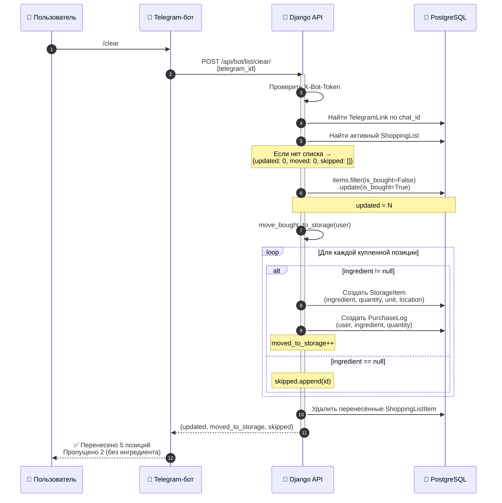

# Workflow `/clear` — список покупок → склад

> Команда `/clear` в Telegram: пометить купленное, перенести в `StorageItem`,
> записать в `PurchaseLog`, очистить список.
> Реализация: `POST /api/bot/list/clear/` (v1.15).

