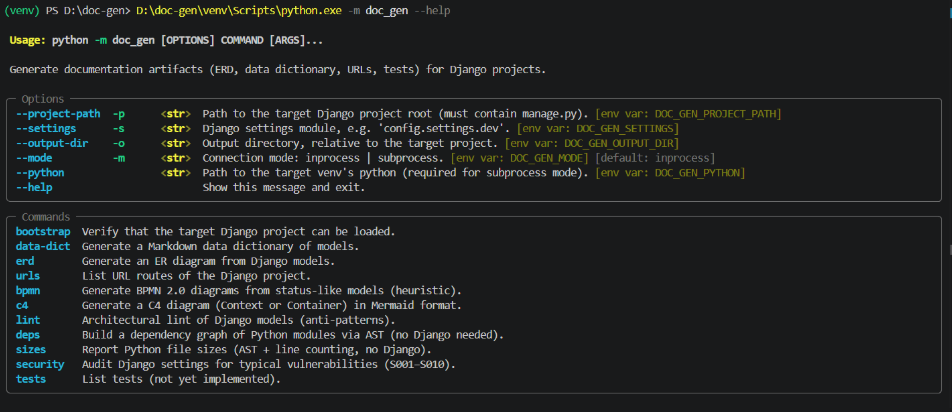
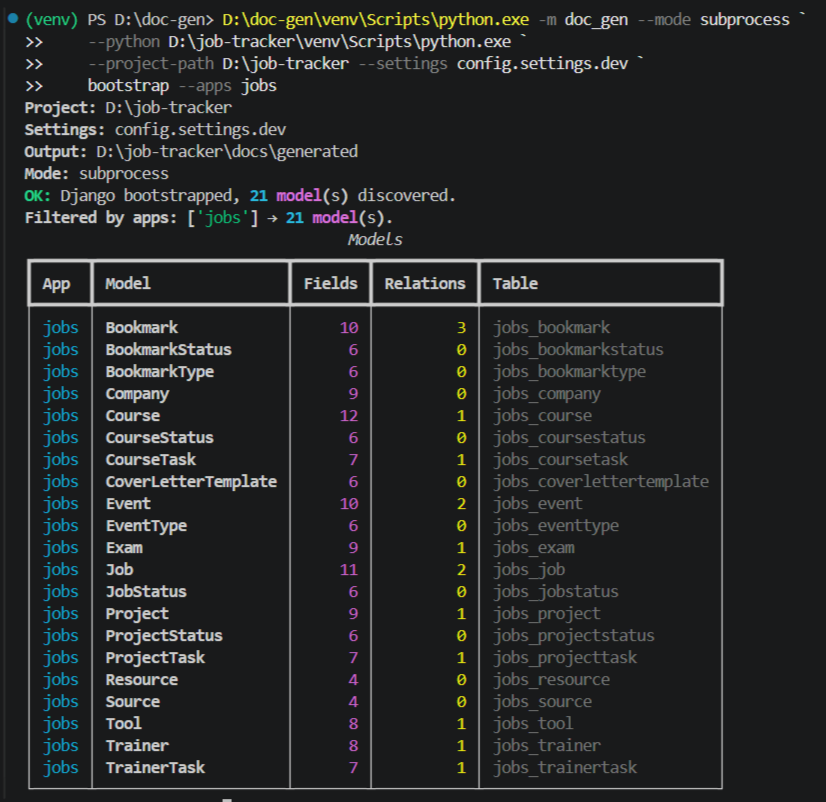
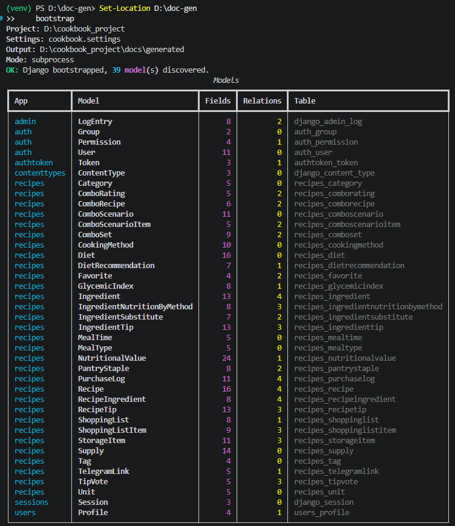
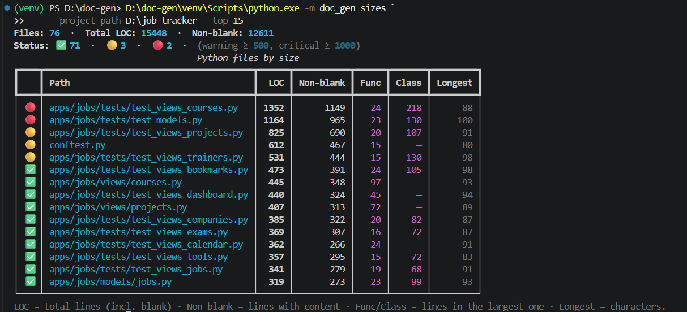
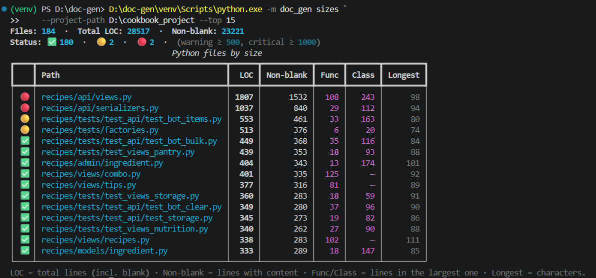
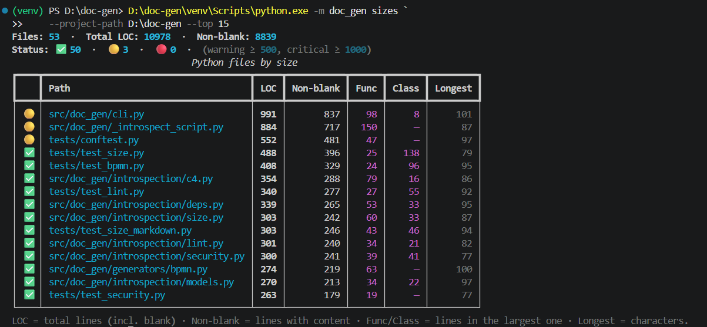

**CLI-инструмент, который автоматически генерирует документацию для Django-проектов.**

Подключается к проекту снаружи, читает модели, URL и бизнес-процессы — и выдаёт готовые артефакты: ER-диаграммы, data dictionary, карты URL, BPMN-схемы, C4-диаграммы, отчёты о качестве и безопасности.

> **Документация = функция от кода.** Никакой ручной синхронизации.

---

## 🎯 Проблема

Документация Django-проекта устаревает **быстрее**, чем её успевают обновлять:

- таблицы моделей,
- ER-диаграммы,
- карты URL,
- описание бизнес-процессов,
- архитектурные диаграммы,
- проверки качества и безопасности.

Аналитик или разработчик тратит **часы** на рутину, а через неделю документация **расходится** с кодом. Её перестают читать, ей не доверяют.

## 🎯 Решение

**`doc-gen`** подключается к Django-проекту и по команде в консоли выдаёт актуальные артефакты.

---

## 📸 Как это выглядит

### 01. Все команды — в одном экране



*10 команд, глобальные опции с поддержкой env-переменных.*

### 02. Модели проекта — одной командой



*`bootstrap` на `job-tracker`: 21 модель, поля, связи, имена таблиц.*

### 03. Большой проект — тоже спокойно



*`bootstrap` на `cookbook_project`: 39 моделей в 7 приложениях. Django + REST API.*

### 04. Размеры файлов — сразу видно проблемы



*`sizes` на `job-tracker`: 76 файлов, 15 448 строк, 2 критичных файла (🔴).*

### 05. Контраст — тот же инструмент, другой проект



*`sizes` на `cookbook_project`: другой профиль, другие находки.*

### 06. Инструмент проверяет и себя



*`sizes` на самом `doc-gen`: самопроверка.*

---

## 🧰 Что умеет

| Команда | Что генерирует | Формат |
|---|---|---|
| `bootstrap` | Список моделей проекта | Rich-таблица в терминале |
| `data-dict` | Data dictionary — модели и поля | Markdown |
| `erd` | ER-диаграмма | Mermaid / PlantUML |
| `urls` | Карта URL-маршрутов | Markdown |
| `bpmn` | BPMN 2.0 — бизнес-процессы | BPMN XML |
| `c4` | Архитектурные диаграммы C4 | Mermaid |
| `lint` | Аудит моделей на анти-паттерны | Markdown |
| `security` | Аудит `settings.py` на уязвимости | Markdown |
| `deps` | Граф зависимостей Python-модулей | Mermaid / Markdown |
| `sizes` | Размеры файлов и метрики | Rich-таблица / Markdown |

**Две категории команд:**

- 🟢 **Django-free** (`deps`, `sizes`) — работают на **любом** Python-проекте.
- 🔵 **Django** (остальные) — требуют подключения к Django-проекту.

---

## 📂 Примеры артефактов

Все примеры ниже сгенерированы **реальными командами** `doc-gen` на двух проектах.

### `job-tracker` — Django + HTMX, 21 модель

- [schema.md](examples/job-tracker/schema.md)
- [c4-context.md](examples/job-tracker/c4-context.md), 
- [c4-container.md](examples/job-tracker/c4-container.md)

### `cookbook_project` — Django + DRF, 39 моделей

- [erd_full.md](examples/cookbook-project/erd_full.md)
- [c4-container.md](examples/cookbook-project/c4-container.md)

---

## 🔍 Что показывает на практике

**`doc-gen` — не «просто генератор картинок».** Он находит реальные проблемы:

- **`sizes`** — критично большие файлы (🔴 > 1000 строк, 🟡 500–1000).
- **`lint`** — 6 анти-паттернов Django-моделей (`max_length`, `related_name`, `auth.User`, `null=True`, `UUIDField`).
- **`security`** — 10 правил безопасности (`DEBUG`, `SECRET_KEY`, `ALLOWED_HOSTS`, SSL/HSTS/cookies).
- **`deps`** — циклические импорты между модулями.

**Exit codes** — `1` при критичных находках. **Готово к встраиванию в CI.**

---

## 🛠️ Как это работает (в двух словах)

```
Django-проект  →  doc-gen  →  готовые артефакты
                    ↓
              (чтение моделей,
               URL, настроек)
```

**Никакого вмешательства в проект.** `doc-gen` подключается снаружи — читает то, что уже есть, и превращает в документацию.

**Два режима подключения:**

- **In-process** — быстро, использует зависимости текущего окружения.
- **Subprocess** — изоляция, использует окружение целевого проекта.

---

## 🎯 Кому это нужно

| Роль | Что получает |
|---|---|
| **Аналитик** | Актуальные таблицы моделей и диаграммы — без ручной работы |
| **Разработчик** | Быстрый обзор чужого проекта: модели, URL, workflows |
| **Тимлид** | Проверку архитектуры: C4, ERD, зависимости, анти-паттерны |
| **Владелец проекта** | Регулярный аудит: размеры, уязвимости, находки |
| **Команда** | Документацию, которая **не устаревает** |

---

## 📝 Контекст

- **10 команд**, покрывающих 90% рутинных задач документации.
- **Проверен на 3 реальных проектах** (`job-tracker`, `cookbook_project`, `cookbook_bot`).
- **390 автотестов**, чистый линтер, зелёный CI на 3 версиях Python.
- **Аудит-фреймворк** — процедура систематической проверки любого Python-проекта.
