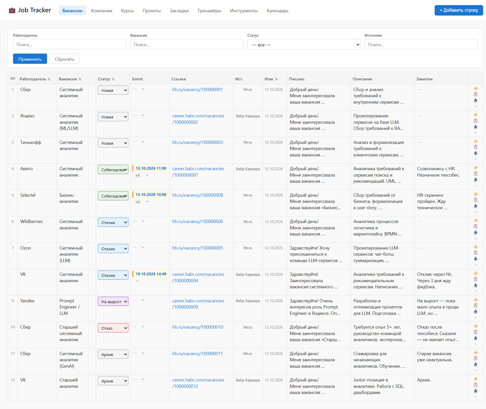
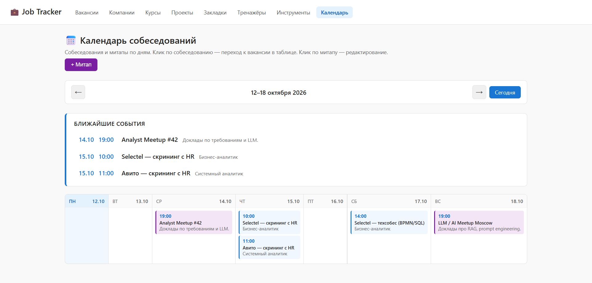
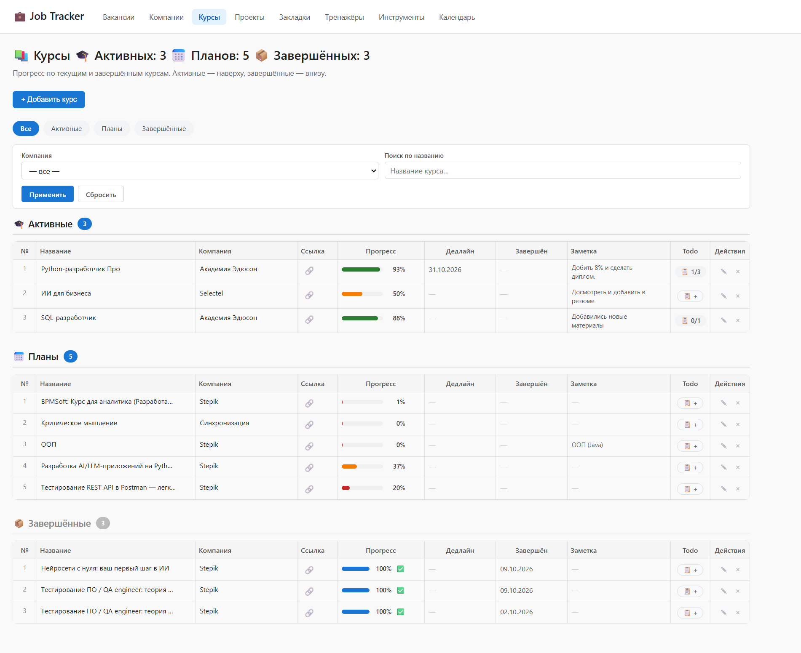
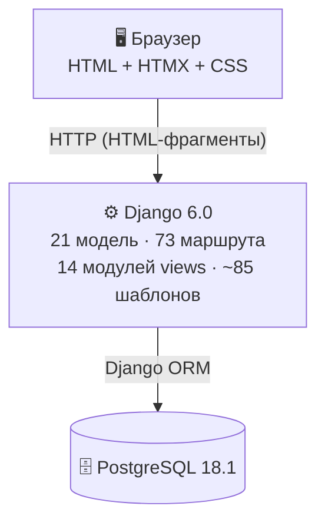

# 📋 Job Tracker

**Личный трекер поиска работы.** Таблица вакансий с редактируемыми ячейками, собеседования и митапы в календаре, трекер курсов с todo-листом, портфолио проектов, закладки, справочник компаний. Всё — на одном экране, без переключения между сервисами.

**Стек:** Django 6.0 + HTMX + PostgreSQL 18
**Тесты:** 688 ✅ · **Покрытие:** 95% · **CI:** ~1 минута

---

## 📸 Как это выглядит

### 01. Вакансии — таблица с редактируемыми ячейками

*Работодатель, вакансия, статус, ближайшее событие, ссылка, источник, письмо, описание, заметки — всё редактируется прямо в таблице. Изменения сохраняются автоматически.*

### 02. Календарь — собеседования и митапы по дням

*Недельная сетка Пн–Вс. Собеседования — синим, митапы — фиолетовым. Плашка «Ближайшие события» — top-3 на сегодня.*

### 03. Курсы — прогресс и todo-лист

*Активные и завершённые курсы, прогресс-бар, дедлайны с подсветкой, todo-лист на каждый курс.*

---

## 🧰 Что внутри

### `/` — Вакансии

Каждая запись — **одна строка таблицы** со всем, что нужно:

- Работодатель, вакансия, ссылка
- **Статус** — цветной выпадающий список (`Новая / Собеседование / Отклик`)
- **Ближайшее событие** — дата, время, тип. Если событий несколько — счётчик `+N`
- **Сопроводительное письмо** — с генерацией по шаблону и копированием в буфер
- **Описание вакансии** — резюме требований и стека  
- **Заметки** — личные пометки

**Всё редактируется прямо в таблице.** Изменения сохраняются автоматически — не надо нажимать «Сохранить».

### `/calendar/` — Календарь

Недельная сетка **Пн–Вс**. На ней:

- **Собеседования** — синие плашки
- **Митапы** — фиолетовые
- **Плашка «Ближайшие события»** — top-3, чтобы не пропустить

Клик по событию — переход к вакансии. Клик по митапу — редактирование.

### `/courses/` — Курсы

Активные — наверху, завершённые — внизу. У каждого курса:

- **Прогресс-бар** 0–100% с цветовой градацией
- **Дедлайн** с подсветкой (просрочен / скоро / близко)
- **Todo-лист** — что осталось сделать
- **Компания** — Stepik, Академия Эдюсон

### `/projects/` — Портфолио

Проекты со статусами (`Идея / MVP / UAT / Готово`), todo-лист на каждый, локальный путь к папке и ссылка на GitHub.

### `/bookmarks/` — Закладки

Что почитать. Статусы (`Читаю / Пусто / Прочитал / Отложено`), типы (`Статья / Книга / Инструкция / Документация`).

### `/trainers/` — Тренажёры

LeetCode, Codewars, SQL-Ex — практика с todo-листом на каждый.

### `/tools/` — Инструменты

Ссылки на полезные сервисы (BPMN.io, Regex101, PlantUML.com).

---

## ✨ Ключевые фичи

- ✏️ **Редактируемые ячейки прямо в таблице** — без отдельных форм редактирования
- 💾 **Автосохранение** — изменения уходят на сервер через 500 мс после ввода
- 🎨 **Цветные статусы** — сразу видно, где что
- 📅 **Календарь и таблица связаны** — событие на календаре привязано к вакансии в таблице
- ✅ **Todo-листы** для курсов, проектов и тренажёров
- 🔍 **Поиск и фильтры** — на каждой странице
- ✨ **Генерация сопроводительного письма** — по шаблонам для Сбера, Яндекса и общий
- 🗂 **Drag&drop задач** — можно перетаскивать задачи в todo-листах

---

## 🏗 Архитектура

**Монолит на Django.** Server-driven UI через Django Templates + HTMX.

---

## 🧪 Качество

| Метрика | Значение |
|---|---|
| Автотесты | **688** |
| Покрытие кода | **95%** |
| Модели | **21** |
| URL-маршруты | **73** |
| Страницы | **9** |
| CI | ✅ GitHub Actions |
| Линтер | ✅ Ruff, 0 ошибок |
| Pre-commit | ✅ Автопроверка на каждый коммит |

**Что это значит:** каждое изменение прогоняется через 688 тестов. Если что-то сломается — узнаю **до** коммита, а не после.

---

## 💼 Что я сделал в этом проекте

- **Спроектировал и реализовал** 8 страниц-трекеров с общим паттерном: таблица, inline-редактирование, поиск, фильтры, модалка.
- **Продумал модель данных** — 21 сущность, связанные FK, справочники статусов, автоматическое определение источников.
- **Настроил prod/dev split** — раздельные БД, порты, `.env`, settings. Никаких случайных правок боевой базы.
- **Настроил автобэкапы** — ежедневный дамп боевой БД через Task Scheduler, ротация 7/4/12.
- **Решил UX-задачи**: сохранение фокуса при inline-правке, drag&drop задач, multi-line paste, автоматическое определение источника из URL.

---

## 🛠 Стек

| Слой | Технологии |
|---|---|
| **Backend** | Python 3.14, Django 6.0 |
| **Frontend** | Django Templates, HTMX 1.9, vanilla JS, SortableJS |
| **БД** | PostgreSQL 18.1 |
| **Тесты** | pytest, pytest-django, pytest-cov |
| **CI/CD** | GitHub Actions, Ruff, pre-commit, Codecov |
| **Окружение** | Windows, PowerShell, venv |

--

## 📄 Лицензия

Личный проект. Не для распространения.

---
⚠️ **Репозиторий проекта приватный.**
